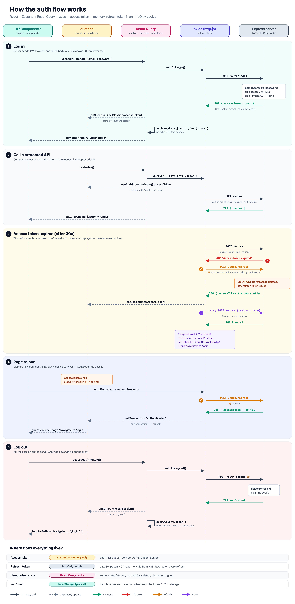

# Auth Flow — React + Zustand + React Query

A complete, runnable authentication flow for class:
register → login → protected routes → roles → silent token refresh → session restore on reload → logout.

```bash
npm install
npm run dev          # API on :4000 + app on http://localhost:5173
```

Demo accounts (password `password123`): `student@demo.dev` (student), `teacher@demo.dev` (admin).

Useful knobs:

```bash
ACCESS_TTL=10 npm run dev   # access token lifetime in seconds (default 30)
LATENCY=1500 npm run dev    # fake network delay in ms (default 400) — makes loading states obvious
```

The server keeps everything in memory, so restarting it wipes new users and sessions. Students who were
logged in just get bounced to /login.

---

## The one idea to teach

| Who owns it?         | Tool            | What lives there                                      |
| -------------------- | --------------- | ----------------------------------------------------- |
| The **client**       | **Zustand**     | `status` (`checking`/`authenticated`/`guest`), `accessToken`, `expiresAt`, `lastEmail` |
| The **server**       | **React Query** | the user (`GET /me`), notes, admin stats, plus login/register/logout as **mutations** |

The user object is not copied into Zustand. Each piece of data has one source of truth.

## The two tokens

| | Access token | Refresh token |
|---|---|---|
| Lifetime | 30 s (short on purpose) | 7 days |
| Where it's sent from the server | JSON body | `httpOnly` cookie, path `/api/auth` |
| Where the client keeps it | Zustand, **memory only** | the browser keeps it; **JS can't read it** |
| Sent how | `Authorization: Bearer …` (axios interceptor) | automatically by the browser |
| Used for | every API call | getting a new access token |

On every refresh the server **rotates** the refresh token: the old one stops working, so a stolen one is only good once.

## The flow



(Source: [docs/auth-flow.html](docs/auth-flow.html). Edit the `PHASES` array and re-screenshot.)

```
 App loads ──► AuthBootstrap: POST /auth/refresh (cookie)
                 ├─ 200 → setSession(token) → status = authenticated
                 └─ 401 → clearSession()     → status = guest

 Login form ──► useLogin().mutate()  POST /auth/login
                 └─ onSuccess: setSession(token)  +  setQueryData(['auth','me'], user)

 Any request ─► http.js request interceptor adds Bearer token
                 └─ 401? ─► refreshSession()  (one shared promise, even for 5 parallel 401s)
                              ├─ ok   → retry the original request with the new token
                              └─ fail → endSessionLocally() → guards redirect to /login

 Log out ─────► useLogout()  POST /auth/logout  → onSettled: clearSession() + queryClient.clear()
```

## File map (read in this order)

| File | What to point out |
|---|---|
| [server/index.js](server/index.js) | two secrets, `requireAuth`, `requireRole`, rotation via `activeRefreshIds`, 401 vs 403 |
| [src/store/authStore.js](src/store/authStore.js) | a store with no provider, `persist` + `partialize` (only `lastEmail`!), selectors |
| [src/lib/http.js](src/lib/http.js) | **the heart:** interceptors, single-flight `refreshSession`, `_retry` flag, `endSessionLocally` |
| [src/features/auth/hooks.js](src/features/auth/hooks.js) | `useMe` with `enabled`, mutations, `setQueryData` instead of refetching |
| [src/components/AuthBootstrap.jsx](src/components/AuthBootstrap.jsx) | why the `checking` status exists |
| [src/components/RouteGuards.jsx](src/components/RouteGuards.jsx) | `RequireAuth` (+ `state.from`), `GuestOnly`, `RequireRole` |
| [src/routes/index.jsx](src/routes/index.jsx) | route objects for `useRoutes`, guards as nested layout routes, `React.lazy` per page (one JS chunk each) |
| [src/App.jsx](src/App.jsx) | `useRoutes(routes)`, and why a custom component can't sit inside `<Routes>` |
| [src/features/notes/hooks.js](src/features/notes/hooks.js) | a protected feature with **zero** auth code in it |
| [src/pages/*](src/pages/) | `isPending` / `isError` / `error` from mutations, `location.state.from` redirect |
| [src/components/DebugPanel.jsx](src/components/DebugPanel.jsx) | classroom only, plus `useShallow` |

React Query Devtools: the flower button, bottom-left. Debug panel: bottom-right.

---

## Run of show (~90 min)

| Time | Segment |
|---|---|
| 0–10 | **Why auth is hard on the client.** Where do you put a token? localStorage (XSS can read it) vs memory (lost on reload) vs httpOnly cookie. Draw the two-token table. |
| 10–25 | **Server tour** (`server/index.js`). Log in with curl or the Network tab: show the JSON token and the `Set-Cookie` header. Paste the token into jwt.io. *"Anyone can read it, so no secrets inside."* |
| 25–40 | **Zustand store.** Open DevTools → Application → Local Storage: only `lastEmail` is there. Ask: *"what if we persisted the token?"* |
| 40–55 | **http.js, live.** Log in, watch the debug countdown hit 0, add a note. Network tab shows `401 → refresh → retry`. Press **Break token**, then **Refetch /me**. Then comment out `refreshPromise` reuse and show the double-refresh logout bug (StrictMode makes it happen on reload). |
| 55–70 | **React Query side.** `useMe` `enabled`, `setQueryData` after login (no extra `/me` call in the Network tab), `invalidateQueries` after adding a note. Log out → log in as teacher → no student notes flash. Then remove `queryClient.clear()` and show the leak. |
| 70–80 | **Routing.** Visit `/admin` logged out → login → you land on `/admin`. Student on `/admin` → 403 page. Reload any page → `checking` spinner → still logged in. **Revoke refresh**, wait for expiry → kicked to /login. |
| 80–90 | **Guards are UX, not security.** Edit `RequireRole` to always render `<Outlet />`: the page shows, but the API still says 403. Hand out exercises. |

## Live-demo tricks

- `LATENCY=1500 npm run dev` → every loading state is visible.
- `ACCESS_TTL=5 npm run dev` → refresh happens all the time.
- Two windows (one normal, one incognito) = two users side by side.

## Exercises for students

1. **Proactive refresh.** Refresh ~5s *before* `expiresAt` with a timer instead of waiting for a 401.
2. **Cross-tab logout.** Logging out in one tab should log out every tab (`BroadcastChannel` or the `storage` event).
3. **Optimistic notes.** Make `useAddNote` show the note immediately (`onMutate` + rollback in `onError`).
4. **Change password** page: a new `POST /auth/change-password` endpoint that also revokes all other sessions.
5. **Form library.** Rebuild the register form with `react-hook-form` + `zod`, keeping the server errors.
6. **Bug hunt.** Remove `original._retry = true` in `http.js`. What happens when the refresh token is revoked? Why?

## Known simplifications (say them out loud)

- In-memory "database", hardcoded secrets, `secure: false` cookie. In production: env secrets, HTTPS, `secure: true`.
- Two tabs refreshing at the exact same moment can race the rotation and log one out. Real systems add a short grace window or reuse detection.
- No rate limiting on `/auth/login`.
